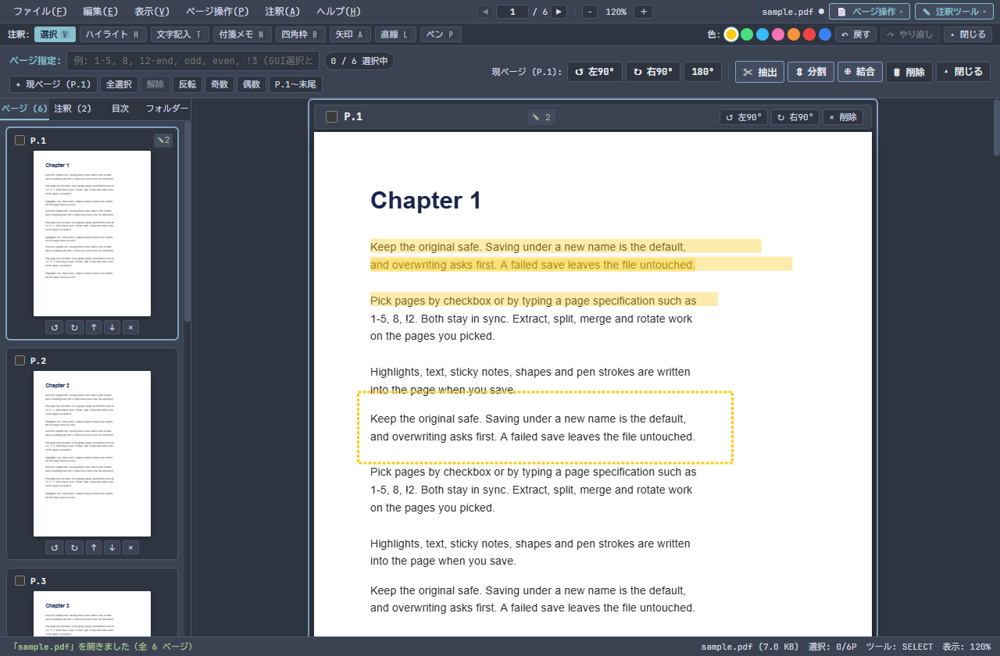

# guif-pdf

[](https://github.com/Az-kijitra/guif-pdf/actions/workflows/ci.yml)
[](LICENSE)

`guif-pdf` は、Windows 10 / 11 向けの、キーボードとマウスで操作する PDF の閲覧・注釈・ページ編集ツールです（**Tauri 2 + Rust + Svelte 5 + PDF.js + pdf-lib** 製）。

GUI ファイラー [`guif`](https://github.com/Az-kijitra/guif) の外部アプリ機能から起動して使うことを想定しており、配色も `guif` に合わせます。単体でも使えます。



---

## インストール

### 方法 1: リリースインストーラーを実行（推奨）

1. [Releases](https://github.com/Az-kijitra/guif-pdf/releases) から最新のインストーラー `guif-pdf_0.1.0_x64-setup.exe` をダウンロードして実行します。
2. 画面の案内に従って進めます。インストール先は既定で `%LOCALAPPDATA%\guif-pdf` です（現在のユーザーのみ、管理者権限不要）。
3. インストールが終わったら、スタートメニューの「guif-pdf」から起動します。

> **SmartScreen の警告が出たとき**
> 本インストーラーにはコード署名がないため、Windows の SmartScreen が「Windows によって PC が保護されました」という警告を出すことがあります。
> 警告が出た場合は、「詳細情報」を選び、表示される「実行」ボタンを押して進めてください。

### 方法 2: ソースコードからビルドする

<details>
<summary>ビルド手順を表示</summary>

必要なもの:

- Windows 10 または Windows 11（64 ビット版）
- Rust 1.90 以上（`cargo`）
- Node.js 22.18 以上（`npm`）
- Microsoft Edge WebView2 ランタイム

```powershell
git clone https://github.com/Az-kijitra/guif-pdf.git
cd guif-pdf/app
npm install

npm run tauri dev     # 開発サーバーで起動
npm run tauri build   # リリースビルドとインストーラーの作成
```

テストと開発の手順は [CONTRIBUTING.md](CONTRIBUTING.md) にあります。
</details>

---

## `guif` から起動する

`guif` で `Ctrl+,` を押して設定ファイル（`%APPDATA%\dev.guif.app\config.toml`）を開き、次の内容を書きます。`guif` を再起動すると、選択中の PDF やフォルダーを `Ctrl+Alt+P` や右クリックメニューから `guif-pdf` で開けます。

> **注意:** `guif` は `[[external_apps]]` を 1 つでも書くと、書いたものだけを使います。既定の 4 つ（ターミナル、VS Code、エクスプローラー、GitHub Desktop）を残すには、次の例のように一緒に書いてください。

```toml
[[external_apps]]
name = "ターミナルで開く"
program = "wt.exe"
args = ["-d", "{dir}"]
key = "Ctrl+Alt+C"

[[external_apps]]
name = "VS Codeで開く"
program = "%LOCALAPPDATA%\\Programs\\Microsoft VS Code\\Code.exe"
args = ["{path}"]
key = "Ctrl+Alt+V"

[[external_apps]]
name = "エクスプローラーで開く"
program = "%SystemRoot%\\explorer.exe"
args = ["{dir}"]
args_for_file = ["/select,", "{path}"]
key = "Ctrl+Alt+E"

[[external_apps]]
name = "GitHub Desktopで開く"
program = "%LOCALAPPDATA%\\GitHubDesktop\\GitHubDesktop.exe"
args = ["{dir}"]
key = "Ctrl+Alt+G"

[[external_apps]]
name = "guif-pdfで開く"
program = "%LOCALAPPDATA%\\guif-pdf\\guif-pdf.exe"
args = ["{dir}"]
args_for_file = ["{path}"]
key = "Ctrl+Alt+P"
```

配色は `guif` の `[theme]` の `preset` に合わせます。`[colors]` と `[font]` は反映されません。

---

## 主な機能

- **閲覧**: 連続スクロール / 単一ページ / 一覧グリッドの表示切替、テキストの選択とコピー、全文検索、目次（しおり）、前回のページとズーム率の復元。
- **注釈**: ハイライト、文字記入（日本語対応）、付箋、四角枠、矢印、直線、手書きペン。元に戻す・やり直しに対応。
- **ページ操作**: 回転、削除、並べ替え、抽出、分割、結合。チェックボックスでの選択と、`1-5, 8, !2` のようなページ指定の入力が連動します。
- **安全な保存**: 既定は別名保存です。上書きは確認の後に行い、途中で失敗しても元のファイルは変わりません。未保存の編集があるときは、閉じる前や別の PDF を開く前に確認します。

操作の詳細は [ユーザーマニュアル](docs/user_manual.md) を参照してください。

---

## 制限事項

使う前に知っておいてほしい点です。詳しくは [ユーザーマニュアルの §6](docs/user_manual.md#6-保存の仕組みと制限事項) にあります。

- **注釈はページに焼き込みます。** 保存した後は、注釈として編集できません。文字記入と付箋は画像として書き込むため、検索の対象になりません。元の PDF を残したいときは別名で保存してください。
- **暗号化された PDF は閲覧のみです。** 権限パスワード付きの PDF は開けますが、編集や保存はできません。開くときにパスワードが必要な PDF は開けません。
- **電子署名は無効になります。** 署名付きの PDF を保存すると、署名は有効でなくなります。
- **抽出・分割・結合の出力には、しおりとフォームを引き継ぎません。** 全ページの保存では引き継ぎます。
- **対応 OS は Windows 10 / 11（64 ビット版）だけです。** 表示とメッセージは日本語のみです。

---

## アンインストール

Windows の「設定」→「アプリ」から「guif-pdf」を選んでアンインストールします。「アプリのデータを削除する」にチェックを入れると、設定（`%APPDATA%\dev.guif.pdf`）も削除します。

---

## ドキュメント

- [ユーザーマニュアル](docs/user_manual.md): 操作方法、ショートカットキー、ページ指定の書式、保存の仕組み、トラブルシューティング
- [仕様](docs/specs/): 保存の動作、`guif` との連携、ページ指定の書式
- [変更履歴](CHANGELOG.md)
- [開発に参加するには](CONTRIBUTING.md) / [セキュリティ](SECURITY.md)

---

## ライセンス

[MIT License](LICENSE)

同梱するソフトウェアとデータ（PDF.js、pdf-lib、CMap データ、標準フォントなど）のライセンスは [THIRD_PARTY_NOTICES.md](THIRD_PARTY_NOTICES.md) にあります。
